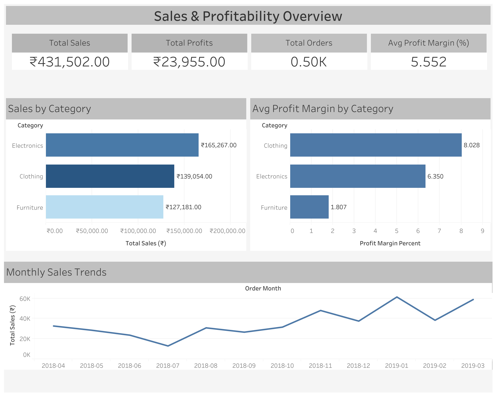

# Data-Driven Business Insights for JAR  
### Uncovering Sales, Profitability, and Regional Performance through Data Analytics  

---

## Project Overview  

This repository presents a complete end-to-end analysis of **JAR’s business data**, conducted as part of the **JAR Business Analyst Intern Assignment**.  

The goal was to analyze sales and performance data to derive **actionable insights**, identify **growth opportunities**, and forecast future trends using **data analytics and visualization**.  

All analyses were performed in **Python**, and insights were visualized through **Tableau dashboards**. The project concludes with a detailed PDF report summarizing key outcomes and business recommendations.

---

## Dataset Information  

Three datasets were provided:  

| Dataset | Description | Key Columns |
|----------|--------------|--------------|
| **List_of_Orders** | Order-level details such as customer, state, and date. | `Order ID`, `Order Date`, `Customer Name`, `State` |
| **Order_Details** | Item-level metrics including sales, profit, and discounts. | `Order ID`, `Category`, `Amount`, `Profit`, `Discount`, `Quantity` |
| **Sales_Target** | Monthly sales targets per product category. | `Month`, `Category`, `Target Sales` |

After preprocessing and merging, a unified dataset was created with:
- 500+ orders across 3 product categories  
- Multiple Indian states  
- Monthly targets for performance comparison  

---

## Business Objectives  

1. **Sales & Profitability:**  
   - Identify top-performing categories and states.  
   - Measure profit margins and sales distribution.  

2. **Targets vs Actuals:**  
   - Compare Furniture category performance against targets.  
   - Highlight underperforming months and regions.  

3. **Forecasting & Trends:**  
   - Predict next 3 months’ sales using time-series forecasting.  
   - Identify trends and seasonality.  

4. **Customer & Regional Insights:**  
   - Segment customers using RFM analysis.  
   - Measure retention through cohort analysis.  

---

## Methodology  

### 1️ **Data Preparation**  
- Cleaned and standardized columns from all input Excel files.  
- Handled missing data, standardized dates, and merged datasets on `Order ID`.  
- Exported processed datasets for analysis and dashboards.  

### 2️ **Exploratory Data Analysis**  
- Generated descriptive statistics for sales, profit, and margin trends.  
- Visualized category-level and time-based performance metrics.  

### 3️ **Regional & Customer Segmentation**  
- Performed **RFM (Recency-Frequency-Monetary)** analysis to classify customer groups.  
- Built **Cohort Retention Heatmaps** to analyze customer behavior over time.  
- Aggregated state-level data for mapping and dashboard use.  

### 4️ **Forecasting & Target Analysis**  
- Applied **Prophet model** (with fallback method) to forecast future sales.  
- Conducted monthly target comparisons for Furniture category.  
- Analyzed deviations and growth expectations.  

### 5️ **Visualization & Reporting**  
- Created export-ready plots and CSVs for Tableau integration.  
- Designed two interactive dashboards summarizing all findings.  

---

## Dashboards  

### **1. Sales & Profitability Overview**

**Purpose:** Summarize total sales, profit, and performance by category.  
**Views:**  
- KPI Cards (Sales, Profit, Orders, Avg Margin)  
- Sales by Category  
- Profit Margin by Category  
- Monthly Sales Trend  

**Insights:**  
- Total Sales ₹431K | Profit ₹23.9K | Avg Margin 5.5%  
- *Electronics* dominates sales, *Clothing* has best margins.  
- *Furniture* lags in profitability → cost optimization needed.
  

---

### **2. Regional & Targets Overview**

**Purpose:** Analyze regional performance, target achievement, and sales forecasts.  
**Views:**  
- Top 5 States (Order Count, Sales, Avg Profit)  
- Furniture Sales vs Target (Actual vs Target)  
- Overall Sales Forecast (Next 3 Months)  

**Insights:**  
- Maharashtra & Madhya Pradesh lead in total sales.  
- Furniture missed multiple monthly targets.  
- Forecast indicates ~10% sales growth next quarter.  

---

## Key Results  

| Focus Area | Key Findings |
|-------------|---------------|
| **Top Category** | Electronics — ₹165K total sales |
| **Highest Margin Category** | Clothing — 8.0% average margin |
| **Underperforming Category** | Furniture — 1.8% average margin |
| **Top States** | Maharashtra, Madhya Pradesh |
| **Sales Forecast** | +10% expected growth next 3 months |
| **Customer Segments** | 4 RFM groups (Champions, Loyal, Potential, Attention) |

---

## Tools & Technologies  

| Stage | Tools |
|--------|--------|
| Data Cleaning | Python (pandas, numpy) |
| Visualization | matplotlib, seaborn |
| Forecasting | Prophet, statsmodels |
| Dashboarding | Tableau |
| Customer Segmentation | scikit-learn (KMeans) |
| Mapping | GeoPandas (for choropleths) |

---

## Key Insights & Recommendations  

1. **Furniture Optimization** — Reassess supplier pricing and discount policies.  
2. **Focus on Clothing** — Highest margin category; invest in marketing.  
3. **Regional Targeting** — Strengthen sales in Gujarat and Punjab (high orders, low margin).  
4. **Retention Strategy** — Introduce loyalty incentives for “Loyal” and “Champion” customers.  
5. **Forecast-Based Planning** — Align inventory and marketing with projected growth months.  

---

## Deliverables  

| File | Description |
|------|-------------|
| `notebooks/` | Python analysis notebooks (01–05) |
| `dashboards/*.twbx` | Tableau dashboards |
| `reports/JAR_BA_Assignment_Report.pdf` | Final PDF report with insights |
| `outputs/tables/*.csv` | Processed datasets for dashboards |
| `outputs/charts/*.png` | Exported visualizations |

---

## Conclusion  

This project demonstrates how structured analytics can turn raw sales data into **strategic business insights**.  
Through data cleaning, visualization, segmentation, and forecasting, the analysis identifies key drivers of performance and suggests **targeted actions for revenue and margin improvement**.

The dashboards serve as executive tools for tracking performance and making **data-informed business decisions**.

---

## Author  

**Sai Datta Putta**  
Integrated M.Sc. Mathematics — NIT Warangal  
📧 saidattaputta@gmail.com  
📞 +91 80192 72866  
🔗 [LinkedIn](https://www.linkedin.com/) | [GitHub](https://github.com/)

---

⭐ *If you found this project helpful or insightful, consider giving it a star!* ⭐
