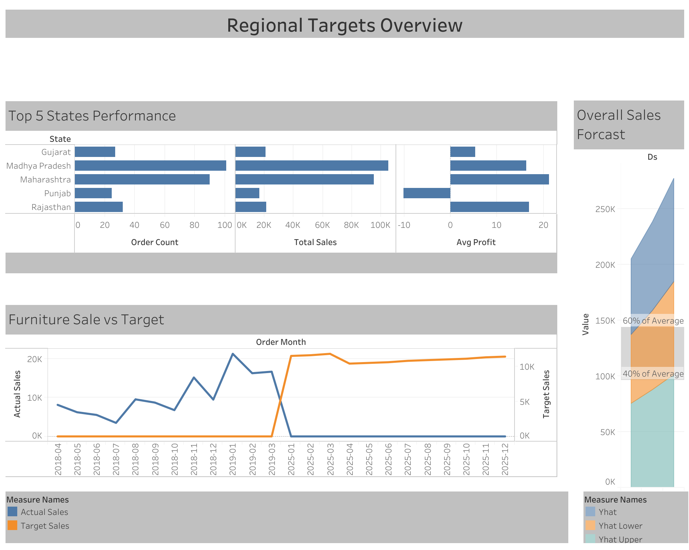
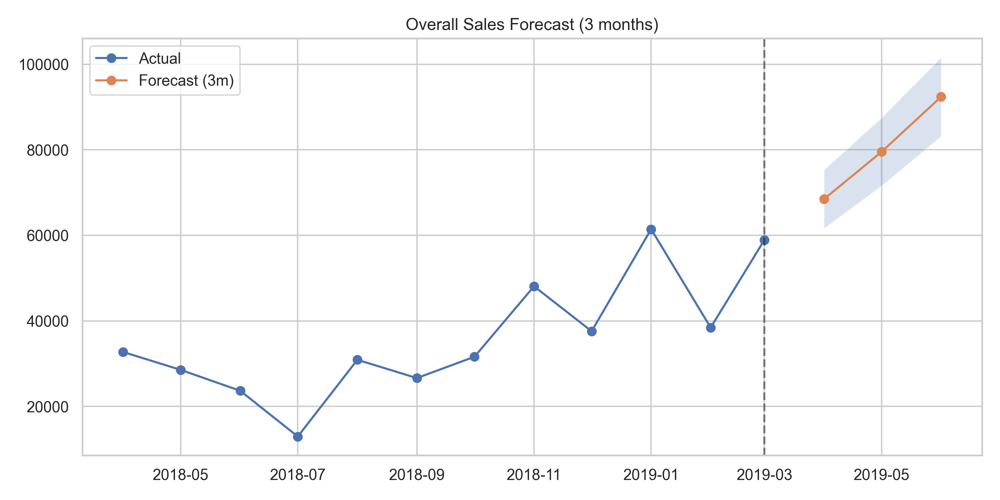

# Data-Driven Business Insights for JAR

A retail analytics case study built from order, order-detail, and sales-target workbooks. The notebooks combine data preparation, sales and profitability analysis, time-series exploration, customer RFM segmentation, K-Means clustering, regional analysis, and a three-month forecast.

## Executive Summary

The committed KPI export reports **₹431,502 in sales**, **₹23,955 in profit**, an **average margin of 5.55%**, and **500 orders**.

The category, regional, customer-segment, and forecasting exports add several decision-oriented findings:

- Electronics records the highest category sales and profit in the category summary, while Clothing has a higher margin percentage.
- Madhya Pradesh and Maharashtra lead the committed state order summary.
- The RFM output labels 185 customers as Loyal and 131 as Champions.
- The saved three-month forecast rises from approximately ₹68.5k in April 2019 to ₹92.4k in June 2019.
- The furniture target-versus-actual export contains a period mismatch: historical actuals cover 2018–March 2019, while target rows cover 2025 and have zero actual sales. This is a data-alignment issue, not evidence that 2025 furniture sales were zero.

All values below come from committed notebook outputs or CSV exports. They have not been regenerated during this documentation review.

## Business Questions

1. Which categories contribute most to sales and profit?
2. How do sales and profitability vary by region?
3. How does monthly sales performance evolve?
4. Which customers are loyal, high-value, or at risk of inactivity?
5. What does the saved short-horizon forecast indicate for planning?
6. Where do sales targets and observed results need closer reconciliation?

## Results and Findings

### Overall KPI snapshot

Source: `outcome/tables/kpis_summary.csv`

| KPI | Saved result |
|---|---:|
| Total sales | ₹431,502 |
| Total profit | ₹23,955 |
| Average margin | 5.55% |
| Orders | 500 |

### Category performance

Source: `outcome/tables/category_summary.csv`

| Category | Total sales | Total profit | Average profit/order | Average margin |
|---|---:|---:|---:|---:|
| Electronics | ₹165,267 | ₹10,494 | ₹34.07 | 6.35% |
| Clothing | ₹139,054 | ₹11,163 | ₹11.76 | 8.03% |
| Furniture | ₹127,181 | ₹2,298 | ₹9.46 | 1.81% |

**Interpretation:** Electronics is the largest category by sales and has the highest total profit in the saved summary. Clothing produces the highest profit margin. Furniture generates substantial sales but has a much thinner margin, making it a candidate for pricing, cost, or discount review.

### Regional performance

Source: `outcome/tables/top_5_states_by_orders.csv`

| State | Sales | Orders | Average profit |
|---|---:|---:|---:|
| Madhya Pradesh | ₹105,140 | 101 | ₹16.33 |
| Maharashtra | ₹95,348 | 90 | ₹21.30 |
| Rajasthan | ₹21,149 | 32 | ₹16.99 |
| Gujarat | ₹21,058 | 27 | ₹5.34 |
| Punjab | ₹16,786 | 25 | **−₹10.15** |

**Interpretation:** Madhya Pradesh and Maharashtra lead the saved regional output. Punjab has a negative average-profit figure despite positive sales, so profitability—not only order volume—should be monitored by state.

### Customer segmentation

Source: `outcome/tables/rfm_segment_counts.csv`

| Segment | Customers |
|---|---:|
| Loyal | 185 |
| Champions | 131 |
| Potential | 120 |
| Needs Attention | 64 |
| **Total** | **500** |

**Interpretation:** 316 customers are classified as Loyal or Champions by the project's RFM rules. The labels are rule- and snapshot-dependent; they are not observed customer-retention outcomes.

The committed K-Means summary contains four clusters:

| Cluster | Customers | Average recency | Average frequency | Average monetary value |
|---|---:|---:|---:|---:|
| 0 | 203 | 83.96 | 1.00 | ₹286.51 |
| 1 | 176 | 282.97 | 1.00 | ₹552.22 |
| 2 | 36 | 157.33 | 1.00 | ₹3,921.25 |
| 3 | 85 | 97.13 | 1.00 | ₹1,588.05 |

**Interpretation:** Cluster 2 is comparatively small but has the highest average monetary value. Cluster 1 has the highest average recency (customers are less recent under the notebook's recency measure). All clusters have an average frequency of 1.00 in this export, so frequency does not appear to separate these clusters meaningfully.

### Monthly sales

Source: `outcome/tables/monthly_sales.csv`

| Month | Sales |
|---|---:|
| 2018-04 | ₹32,726 |
| 2018-05 | ₹28,545 |
| 2018-06 | ₹23,658 |
| 2018-07 | ₹12,966 |
| 2018-08 | ₹30,899 |
| 2018-09 | ₹26,628 |
| 2018-10 | ₹31,615 |
| 2018-11 | ₹48,086 |
| 2018-12 | ₹37,579 |
| 2019-01 | ₹61,439 |
| 2019-02 | ₹38,424 |
| 2019-03 | ₹58,937 |

Sales vary materially month to month, with the highest saved actual month in this table being January 2019 at ₹61,439. The three-month moving average is also included in the CSV.

### Three-month forecast

Source: `outcome/tables/overall_sales_forecast_3m.csv`

| Forecast month | Forecast | Lower bound | Upper bound |
|---|---:|---:|---:|
| 2019-04 | ₹68,463 | ₹61,617 | ₹75,309 |
| 2019-05 | ₹79,528 | ₹71,576 | ₹87,481 |
| 2019-06 | ₹92,382 | ₹83,144 | ₹101,621 |

The saved forecast indicates an upward trajectory over the three forecast months. These are historical saved outputs, not a current forecast. The forecast should be evaluated on a chronological holdout before being used for operational planning.

### Target comparison — data caveat

The committed `furniture_targets_vs_actuals.csv` includes actual sales for April 2018–March 2019 but target rows for January–December 2025 with zero actual sales. Because those periods do not overlap, the file does not support a valid like-for-like target attainment conclusion. The date alignment should be reviewed before drawing conclusions about target achievement.

## Visualizations and Exports

The repository contains chart images under `outcome/charts/` and in the project root:

- Category sales and profit-margin comparisons
- Monthly sales and moving-average trends
- Overall three-month sales forecast
- Furniture sales versus target
- RFM clusters and customer monetary/recency patterns
- Regional order-count summaries
- Time-series decomposition and correlation matrix






## Analysis Workflow

| Notebook | Work performed |
|---|---|
| `data_prep.ipynb` | Read, clean, join, and enrich the order, detail, and target data |
| `exploratory_data_analysis.ipynb` | Explore sales, profit, category mix, distributions, and correlations |
| `forcasting_and_targets.ipynb` | Time-series decomposition, moving averages, forecast, and target comparison |
| `regional_and_segment_analysis.ipynb` | Regional summaries, RFM scoring, and K-Means customer segmentation |

## Repository Structure

```text
.
├── data/Raw_Data/                 # Original order, detail and target workbooks
├── outcome/
│   ├── charts/                    # Saved plots
│   └── tables/                    # KPI, category, region, RFM and forecast CSVs
├── outcomes/tables/               # Additional time-series decomposition export
├── data_prep.ipynb
├── exploratory_data_analysis.ipynb
├── forcasting_and_targets.ipynb
├── regional_and_segment_analysis.ipynb
├── Sales_and_Profitability_Overview.png
├── Regional_Tragets_Overview.png
└── README.md
```

Both `outcome/` and `outcomes/` are retained as found in the repository; they have not been merged or renamed.

## Reproducing the Analysis

```bash
git clone https://github.com/saidattaputta/Data-Driven-Business-Insights-for-JAR.git
cd Data-Driven-Business-Insights-for-JAR
python -m venv .venv
source .venv/bin/activate  # Windows: .venv\\Scripts\\activate
pip install pandas numpy matplotlib seaborn scikit-learn statsmodels openpyxl jupyter
jupyter notebook
```

Open the notebooks from the repository root and execute them in the order listed above. The forecast notebook has a Prophet path and a fallback path; install Prophet separately if using the Prophet route. Some notebook cells refer to generated paths that differ from the committed `outcome/` export layout, so inspect their configured paths before executing.

## Tools

Python, pandas, NumPy, Matplotlib, Seaborn, scikit-learn, statsmodels, Prophet (forecast path), Excel, and Jupyter Notebook.

## Limitations and Data Quality Notes

- This is an exploratory case study based on the supplied workbook period and data definitions.
- The average margin and profit figures depend on the source workbook's profit definition.
- RFM segments and K-Means clusters depend on the snapshot date, feature scaling, and thresholds.
- The saved forecast is historical and has not been validated against a separately held-out future period in this review.
- The furniture target export has a 2018–2019 actual versus 2025 target date mismatch.
- A folder-name discrepancy exists between `outcome/` and `outcomes/`; both have been preserved.

## Recommendations Suggested by the Saved Analysis

1. Review furniture margin performance before prioritizing further category growth.
2. Maintain the Electronics sales contribution while studying Clothing's stronger reported margin.
3. Investigate Punjab's negative average profit in the regional summary.
4. Consider differentiated customer actions for the 64 customers in the Needs Attention segment.
5. Reconcile the target dates before using the forecast and target comparison for planning.

---

**Sai Datta Putta**

[LinkedIn](https://www.linkedin.com/in/sai-datta-putta/)
